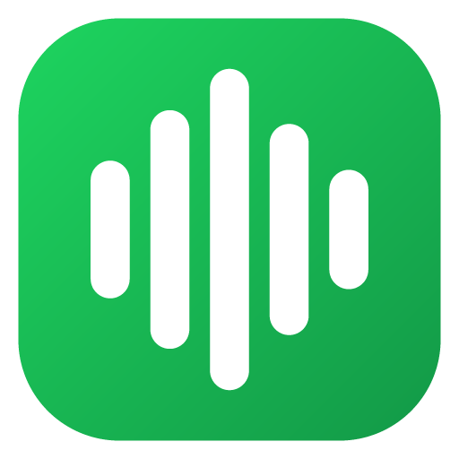
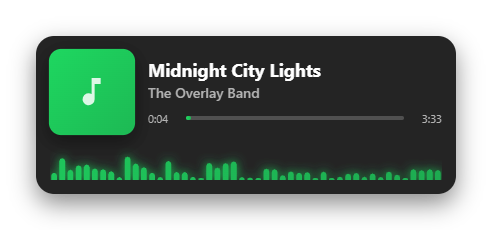
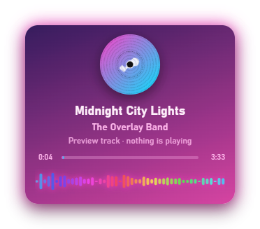
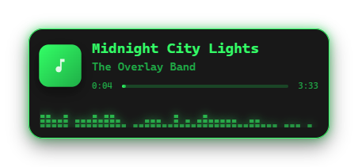
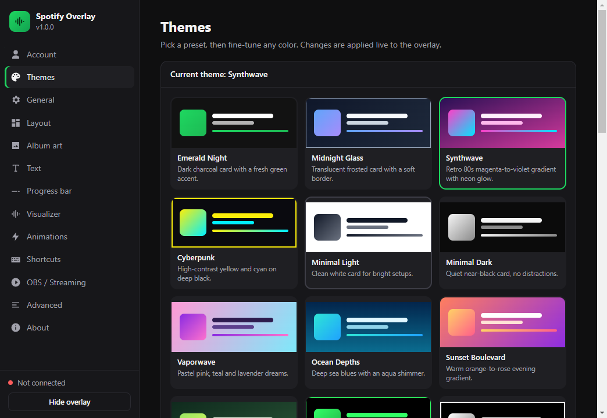
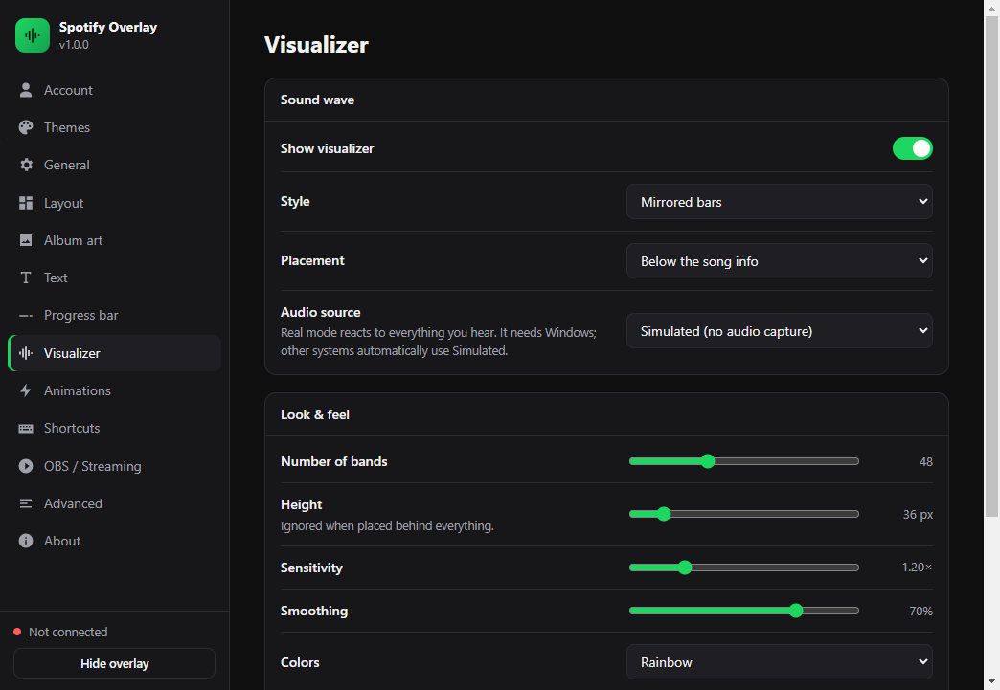

<div align="center">



# Spotify Overlay

**A highly customizable, always-on-top “now playing” overlay for Spotify, with album art, live progress, audio visualizers and 56 built-in themes, and a pet that brings it on screen.**

Free and open source. It works on Windows, macOS and Linux, and also as an OBS browser source for streamers.

[Download](https://github.com/davCreate/Spotify-Overlay/releases) · [Setup guide](#-setup-2-minutes) · [Features](#-features) · [Themes](#-themes) · [FAQ](#-faq--troubleshooting) · [Contributing](CONTRIBUTING.md)

<br>





</div>

---

## ✨ Features

**Live now-playing card**
- Song title, artist, album and the device it's playing on, updated in real time while Spotify plays in the background.
- Album art in four shapes: square, rounded, circle or a **spinning vinyl record** that **pulses to the beat**.
- A smooth progress bar with elapsed/total time, interpolated between updates.
- Long titles scroll automatically (marquee).
- Podcasts and episodes are supported.

**Sound-wave visualizer**
- 7 styles: bars, mirrored bars, LED blocks, dots, wave, waveform lines and circle.
- **Real system audio** on Windows (WASAPI loopback). It reacts to what you actually hear.
- A **simulated** mode for macOS, Linux and OBS. It only animates while music is playing.
- Placement below or above the song info, or behind everything. Colors can follow the accent, a gradient, a rainbow or the text color. Glow, sensitivity, smoothing, band count, height, opacity and FPS limit are all adjustable.

**56 themes in 9 categories + a full theme editor**
- Categories: Normal, Minimal, **3D**, Glass, Neon & Glow, **Animated**, Retro, Colorful & Nature and Streaming. Each theme card shows its background, effect and font.
- **19 visual effects**: 3D tilt, 3D extruded block, 3D stacked cards, soft 3D (neumorphism), neon tube, holographic foil, aurora, shimmer, CRT scanlines, pixel/8-bit, sticker, and seven animated 3D effects: **3D orbit**, **3D hover**, **3D box** (real top, bottom and side faces), **3D parallax** (cover and text at different depths), **hologram projector**, **beat pulse 3D** (jumps toward you on the beat) and **hanging sign**. Any effect can be combined with any colors.

**Pets**
- Turn on a pet in Settings → Pets and it delivers every new song. When a song changes, the pet walks in, **takes the old card off screen**, brings the new one back, shows it off with sparkles, sets it down, **dances to the music** with floating notes, waves and walks away. The card never blinks while it moves.
- The first pet is **Claude**, a little orange helper with a walk cycle, blinking eyes and a twinkling antenna. You can pick the edge it comes from, its size and walking speed, and play the animation from Settings. It also works in the OBS browser source.
- Background styles: solid, gradient, glass, **blurred album art**, or fully transparent.
- **Album-adaptive colors**: accent colors are extracted from each cover.
- Edit every color, border, shadow, glow, font and effect. Save your own themes, and export or import them as JSON to share.

**Extensive settings** (75+ options in 13 sections)
- **Overall size** from 50% to 300%. Everything grows or shrinks together and keeps its proportions. Use the slider and the Small/Normal/Large/Extra large buttons in Settings → Layout, the tray menu, or the shortcuts.
- Layouts: horizontal, vertical, compact and minimal (text only). Width, padding, spacing, corner radius and opacity.
- Song-change transitions (fade, slide, zoom, flip, blur) with an adjustable duration, plus idle animations (float, breathe).
- Smart visibility: hide when idle, hide after being paused for N seconds, or **auto-hide** (the overlay pops in on song change, then fades out, which is perfect for gaming).
- **Click-through lock**: the overlay never blocks the game or app under it. Unlock it to drag it anywhere.
- Global shortcuts you can rebind, a tray icon, launch at startup, and start hidden.
- A demo track while Settings is open, so you can design your overlay without music.
- Settings backup: export and import, plus reset.
- **Built-in updates**: Settings → Updates checks GitHub for new versions. On the Windows installer and the Linux AppImage, one click downloads and installs the update, so you never have to reinstall.

**Built for streamers**
- A built-in **OBS / Streamlabs browser source** at `http://127.0.0.1:4777/` with a transparent background. Changes show up live.

**4 languages**
- The app is available in English, Spanish, French and Russian. Pick one in Settings → General → Language, or leave it on *Automatic* to follow your system language.

**Private by design**
- You use **your own** free Spotify developer app (PKCE, no client secret). The app talks only to Spotify's official API, plus GitHub to check for updates (you can turn that off).
- Tokens are encrypted with your OS keychain (Electron `safeStorage`). There's no analytics, no telemetry and no external server.

---

## 📥 Installation

### Option A: download a release
Get the latest installer from the [**Releases page**](https://github.com/davCreate/Spotify-Overlay/releases):

| OS | File |
|---|---|
| Windows | `Spotify-Overlay-Setup-x.y.z.exe` (installer, recommended: updates itself) or `Spotify-Overlay-x.y.z-portable.exe` (portable, no install) |
| macOS | `.dmg` (Apple Silicon / M-series only for now. Intel Macs are not supported yet.) |
| Linux | `.AppImage` (updates itself) or `.deb` |

> The builds are not code-signed. On Windows, SmartScreen may say “Windows protected your PC”. Click **More info → Run anyway**. On macOS, right-click the app and choose **Open** the first time.

Nothing else is needed to run the app. You don't need Node.js or any other software. After installing, follow the [Setup guide](#-setup-2-minutes) to connect your Spotify account.

### Updating
You only install the app once. Open **Settings → Updates** (or the tray menu → *Check for updates…*) and click **Check for updates**. The app also checks by itself shortly after launch and every 6 hours, and shows a notification when a new version is out. You can turn this off in the same section.

- **Windows installer and Linux AppImage:** click **Download and install**, then **Restart and update**. Your settings and Spotify login are kept.
- **macOS, Windows portable and `.deb`:** these builds cannot replace themselves. The app tells you when an update is out and opens the download page, then you install the new version over the old one.

### Option B: run from source
Requirements: [Node.js](https://nodejs.org/) 18 or newer and Git.

```bash
git clone https://github.com/davCreate/Spotify-Overlay.git
cd Spotify-Overlay
npm install
npm start
```

To build your own installer, run `npm run dist` (or `dist:win`, `dist:mac` or `dist:linux`). The output goes to `dist/`.

---

## 🔑 Setup (2 minutes)

Spotify only shares your playback data with an app you authorize. Each user creates their own free Spotify “developer app”. This takes about two minutes and needs no programming.

1. Open the [**Spotify Developer Dashboard**](https://developer.spotify.com/dashboard) and log in with your normal Spotify account. Accept the developer terms if asked.
2. Click **Create app**.
   - **App name / description**: anything you like, for example `My Overlay`.
   - **Redirect URIs**: add exactly
     ```
     http://127.0.0.1:8888/callback
     ```
     and click **Add**.
   - **Which API/SDKs are you planning to use?** Tick **Web API**.
   - Accept the terms and click **Save**.
3. Open your new app → **Settings**, and copy the **Client ID**. You do **not** need the Client Secret.
4. In Spotify Overlay, go to **Settings → Account**, paste the Client ID and click **Connect Spotify**.
5. Your browser opens. Click **Agree**. The overlay now shows what you are playing. 🎉

> **Port 8888 already in use?** Change the *Redirect port* in Settings → Account. Then update the Redirect URI in your Spotify app to match, for example `http://127.0.0.1:9999/callback`.

**Permissions requested:** `user-read-currently-playing` and `user-read-playback-state`. These are read-only. The app cannot control playback or change your account.

---

## 🖱️ Everyday use

| Action | How |
|---|---|
| Open settings | Click the tray icon, or right-click it → *Settings…* |
| Move the overlay | Unlock it (tray menu or `Ctrl+Shift+L`), drag it, then lock it again |
| Show / hide | `Ctrl+Shift+O` or the tray menu |
| Make it bigger / smaller | `Ctrl+Alt+Up` / `Ctrl+Alt+Down`, tray menu → *Size*, or Settings → Layout → Size |
| Update the app | Tray menu → *Check for updates…*, or Settings → Updates |
| Quit | Tray menu → *Quit* |

When **locked**, the overlay is fully click-through: your mouse clicks go to the window underneath. On first launch it is unlocked, so you can place it where you want.

> **Games:** the overlay shows on top of windowed and *borderless fullscreen* games. *Exclusive fullscreen* games draw over every other window, so switch the game to borderless mode or use the OBS browser source.

---

## 🎨 Themes

Settings → Themes groups the 56 themes into categories. Click a category chip to show only that category.

| Category | Themes |
|---|---|
| **Normal** | Emerald Night, Nocturne, Arctic Frost, Gold Luxe, Album Adaptive, Espresso |
| **Minimal** | Minimal Light, Minimal Dark, Monochrome |
| **3D** | Tilted Stage (3D tilt), Solid Block and Isometric (extruded), Card Deck (stacked cards), Soft Clay and Soft Night (neumorphism), Sapphire Orbit and Golden Turntable (3D orbit), Hover Mint and Cloud Nine (3D hover), Neon Cube, Toy Block and Obsidian Box (3D box), Depth Field and Paper Layers (3D parallax), Hologram and Mars Projection (hologram projector), Bass Drop and Heartbeat (beat pulse 3D), Cafe Sign (hanging sign) |
| **Glass** | Midnight Glass, Frosted Ice, Smoked Glass, Rose Glass |
| **Neon & Glow** | Synthwave, Cyberpunk, Neon Tokyo, Toxic, Electric Blue |
| **Animated** | Aurora, Holographic, Lava Lamp, Liquid Gold |
| **Retro** | Retro Terminal, Amber CRT, Arcade 8-bit, Vaporwave, Bubblegum Sticker |
| **Colorful & Nature** | Ocean Depths, Sunset Boulevard, Forest Canopy, Sakura, Desert Dunes, Galaxy |
| **Streaming** | Stream Clean, Stream Lower Third, Chroma Key |



Any theme can be tweaked in **Settings → Themes**. Click **Save as new theme** to keep your version, or **Export…** to share it as a `.json` file. See [docs/THEMES.md](docs/THEMES.md) for the theme file format and how to contribute a theme.

---

## 🔊 Visualizer: how it works



Spotify's Web API no longer gives new apps access to audio-analysis data. Real-time visuals therefore come from your computer's audio output:

- **Windows: Real system audio (default).** The app uses WASAPI loopback to read the audio your PC is playing and runs an FFT on it. The visualizer reacts to everything you hear, not only Spotify. Nothing is recorded or saved.
- **macOS / Linux / OBS: Simulated.** A music-like animation that runs only while a song is playing. You can also choose it on Windows if you prefer.

If real audio capture fails for any reason, the app falls back to simulated mode automatically.

---

## 📺 OBS / Streamlabs

1. Go to **Settings → OBS / Streaming** and enable **Browser source**.
2. In OBS, click **Sources → + → Browser**. Set the URL to `http://127.0.0.1:4777/`, the width to about `900` and the height to about `400`.
3. Done. The background is transparent, and all your settings and themes apply live.

The server listens on `127.0.0.1` only, so other devices on your network cannot reach it.

---

## ⚙️ Settings reference

<details>
<summary><b>Click to expand the full list</b></summary>

| Section | Options |
|---|---|
| **Account** | Client ID, redirect port, connect/disconnect |
| **Themes** | 56 presets in 9 categories, custom themes, import/export; visual effect, background style, colors ×6, album-adaptive colors, gradient angle, background opacity, album blur, border width/color, shadow, glow, font |
| **General** | Launch at startup, start hidden, refresh interval (0.5–10 s), hide when idle, hide when paused (+ delay), auto-hide (+ duration), demo track while Settings is open |
| **Layout** | Overall size (50–300%, proportional) with quick size buttons, horizontal / vertical / compact / minimal, width, padding, spacing, corner radius, opacity, lock position, reset position |
| **Album art** | Show, size, shape (square/rounded/circle/vinyl), spin, beat pulse, shadow |
| **Text** | Show title/artist/album/device, alignment, sizes, title weight, uppercase, text shadow, scrolling titles |
| **Progress bar** | Show, time labels, thickness, rounded ends, knob |
| **Visualizer** | On/off, 7 styles, placement, audio source, bands, height, sensitivity, smoothing, color mode, opacity, glow, FPS limit |
| **Animations** | Song-change transition (6 types), duration, idle animation |
| **Shortcuts** | Show/hide overlay, lock/unlock (rebindable, with conflict detection) |
| **OBS / Streaming** | Enable browser source, port |
| **Advanced** | Export/import settings, open settings folder, reset everything |

Settings are stored as JSON in:
- Windows: `%APPDATA%\spotify-overlay\settings.json`
- macOS: `~/Library/Application Support/spotify-overlay/settings.json`
- Linux: `~/.config/spotify-overlay/settings.json`

</details>

---

## ❓ FAQ / Troubleshooting

<details>
<summary><b>“INVALID_CLIENT: Invalid redirect URI” in the browser</b></summary>

The Redirect URI in your Spotify app must match **exactly** the one shown in Settings → Account, for example `http://127.0.0.1:8888/callback`. Use `127.0.0.1`, not `localhost`, with no trailing slash, and with the same port.
</details>

<details>
<summary><b>“Port 8888 is already in use”</b></summary>

Another program is using that port. Pick a different redirect port in Settings → Account and add the matching Redirect URI in the Spotify dashboard.
</details>

<details>
<summary><b>The overlay says “Nothing playing” but music is playing</b></summary>

Spotify only reports playback from an active Spotify Connect device. Press play or pause once in Spotify. Private sessions and local files may report limited information. Also check that the right Spotify account is connected.
</details>

<details>
<summary><b>“Rate limited by Spotify, retrying in …”</b></summary>

Spotify limits how often an app may ask what is playing, and a long wait (hours) is tied to your Client ID. On Windows, version 1.0.4+ reads the Spotify desktop app directly, so the overlay keeps working while the desktop app plays, even during a rate limit or without logging in. To clear the limit sooner (for example when listening on another device), create a new app in the Spotify Developer Dashboard and paste its Client ID in Settings → Account. Keep the refresh interval at 3000 ms or more.
</details>

<details>
<summary><b>“Your Spotify session expired”</b></summary>

The authorization was revoked or your Client ID changed. Click **Connect Spotify** again.
</details>

<details>
<summary><b>The visualizer doesn't move</b></summary>

With *Real system audio*, the visualizer only moves when sound is actually playing through your default output device. Check the volume isn't muted, or switch to *Simulated*. On macOS and Linux, simulated mode is always used.
</details>

<details>
<summary><b>The overlay doesn't show over my game</b></summary>

Run the game in **borderless / windowed fullscreen**. Exclusive fullscreen draws over every other window.
</details>

<details>
<summary><b>I lost the overlay off-screen</b></summary>

Use **Settings → Layout → Move overlay back to the top-right corner**. The app also resets the position automatically if the saved position is no longer on any monitor.
</details>

<details>
<summary><b>Does it work with a free Spotify account?</b></summary>

Yes. Reading what's playing works on both Free and Premium accounts.

Your personal Spotify app runs in Spotify's *Development mode*. You are its owner, so you always have access and need no approval from Spotify. Spotify sometimes changes the rules for Development-mode apps. If you can't create an app or log in, check the current [Spotify developer terms](https://developer.spotify.com/terms) and open an [issue](https://github.com/davCreate/Spotify-Overlay/issues).
</details>

---

## 🚧 Known limitations and coming soon

Current limitations:

- The builds are not code-signed, so Windows and macOS show a warning on first launch (see [Installation](#-installation)).
- The macOS build supports Apple Silicon only. Intel Macs are not supported yet.
- The real-audio visualizer works on Windows only. macOS, Linux and OBS use the simulated visualizer.

Planned: more pets, and pet idle poses while music is paused.

New versions show up in the app itself (Settings → Updates). Star or watch the repository to get notified about new releases. Ideas and bug reports are welcome on the [Issues page](https://github.com/davCreate/Spotify-Overlay/issues).

---

## 🏗️ Project structure

```
src/
├── main/            Electron main process
│   ├── main.js          windows, tray, shortcuts, IPC
│   ├── spotify-auth.js  OAuth 2.0 PKCE login (loopback redirect)
│   ├── spotify-client.js polling, token refresh, rate-limit handling
│   ├── windows-media.js  Windows: reads the Spotify desktop app (no Web API calls)
│   ├── store.js         validated, persisted settings
│   ├── token-store.js   encrypted token storage
│   ├── obs-server.js    local browser-source server (SSE)
│   └── updater.js       update checks and in-app installs (GitHub releases)
├── preload/preload.js   safe bridge (contextIsolation + sandbox)
├── renderer/
│   ├── overlay/         the overlay card + visualizer (also used by OBS)
│   └── settings/        settings window (schema-driven UI)
└── shared/              defaults & themes shared by every process
```

There is no framework and no bundler: plain HTML, CSS and JavaScript. `npm test` runs the unit tests, and `npm run lint` syntax-checks every file. `npx electron . --smoke-test=<dir>` launches the app with a temporary profile, screenshots every screen and exits.

---

## 🤝 Contributing

Pull requests are welcome, especially new themes, visualizer styles and translations. Read [CONTRIBUTING.md](CONTRIBUTING.md) and our [Code of Conduct](CODE_OF_CONDUCT.md). Found a security issue? See [SECURITY.md](SECURITY.md).

## 📄 License

[MIT](LICENSE) © davCreate

## ⚖️ Disclaimer

This project is not affiliated with, endorsed by, or sponsored by Spotify. “Spotify” is a trademark of Spotify AB. The project uses the public [Spotify Web API](https://developer.spotify.com/documentation/web-api) under the [Spotify Developer Terms](https://developer.spotify.com/terms). Album artwork and metadata are provided by Spotify and belong to their respective owners.
